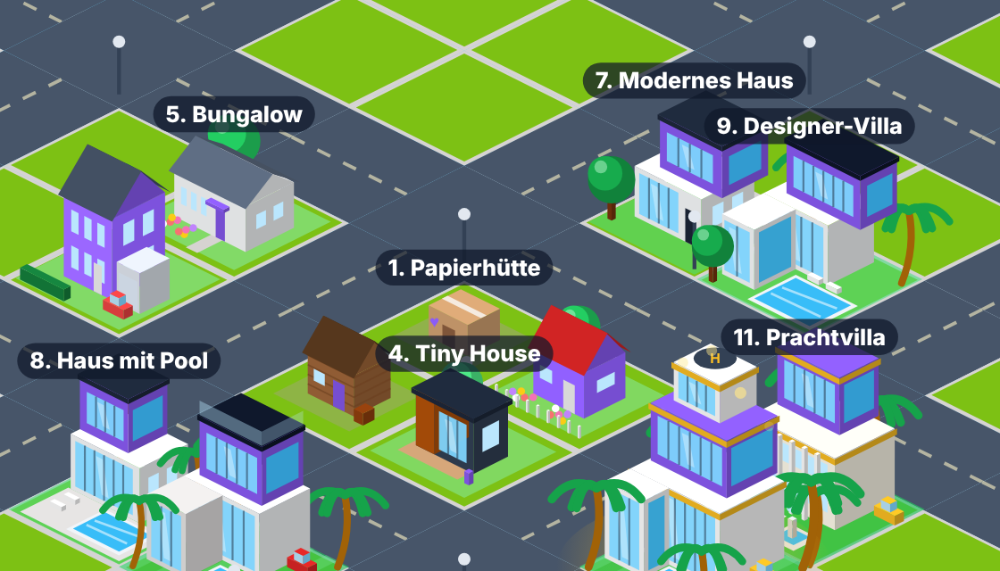

# 🏡 Zuschauer-Stadt – Anleitung für deinen Live

Jeder Zuschauer zieht in eine **Papierhütte**. Wer im Chat schreibt, baut sein Zuhause aus,
Stufe für Stufe bis zur **Riesen-Villa**. Je mehr Leute in der Stadt wohnen, desto schöner wird
**die ganze Stadt**: bessere Straßen, Laternen, Bäume, ein wachsendes Rathaus, Autos und Wahrzeichen,
über die der Chat abstimmt. Ein **Bürgermeister** redet die ganze Zeit mit dem Chat.

**Alles wird gespeichert.** Beim nächsten Live geht es genau dort weiter: gleiche Häuser, gleiche
Stadtstufe, Stammgäste werden begrüßt, und der Bürgermeister erzählt, was letztes Mal passiert ist.

| Die Stadt im Live | Die Häuser aus der Nähe |
|---|---|
|  |  |

Das Programm läuft **auf deinem Computer** während des Lives und liest jeden Kommentar,
jeden neuen Zuschauer, jeden Follow, jedes Teilen, die Likes und die Geschenke mit.

---

## Die Häuser (12 Stufen pro Zuschauer)

| Punkte | Zuhause |
|---|---|
| 0 | Papierhütte |
| 2 | Holzhütte |
| 5 | Gartenhäuschen |
| 9 | Tiny House |
| 14 | Bungalow |
| 21 | Einfamilienhaus |
| 30 | Modernes Haus |
| 42 | Haus mit Pool |
| 58 | Designer-Villa |
| 80 | Luxusvilla |
| 110 | Prachtvilla |
| 150 | Riesen-Villa |

## Die Stadt (6 Stufen, je nach Einwohnerzahl)

| Einwohner | Stadt | Was sich verbessert |
|---|---|---|
| 0 | Siedlung | Feldwege, Büsche, Zelt als Rathaus |
| 8 | Dorf | Kopfsteinpflaster, Holzlaternen, kleines Holz-Rathaus |
| 20 | Kleinstadt | Asphalt mit Mittellinie, Straßenlaternen, Bäume, Rathaus mit Uhrturm, **1. Wahrzeichen** |
| 40 | Stadt | Gehwege, Zebrastreifen, Parkbänke, moderne Laternen, Autos, Rathaus mit Säulen, **2. Wahrzeichen** |
| 75 | Großstadt | Radwege, LED-Laternen, Blumenkübel, Rathaus mit Kuppel, **3. Wahrzeichen** |
| 150 | Metropole | Goldene Prachtlaternen, Boulevard mit Goldstreifen, goldenes Rathaus |

- **Wahrzeichen:** Bei Kleinstadt, Stadt und Großstadt startet eine **Abstimmung** (45 Sekunden).
  Der Chat schreibt `1`, `2` oder `3` (oder den Namen): Riesenrad, Park mit Teich oder Springbrunnen.
  Der Sieger wird neben dem Rathaus gebaut.
- **Verkehr:** Ab der Kleinstadt fahren Autos. Je mehr Zuschauer gerade live sind, desto mehr Autos.
- **Stammgäste:** Wer an 3 verschiedenen Tagen da war, bekommt einen ⭐ am Namen.

## Punkte

| Aktion | Punkte |
|---|---|
| Kommentar | +1 (höchstens alle 2 Sekunden pro Person, gegen Spam) |
| Folgen | +5 und eine Fahne aufs Dach |
| Live teilen | +3 |
| Likes | +1 je 50 Likes |
| Geschenk | +1 pro Diamant. Ab 100 Diamanten: 30 Sekunden Bau-Rush für alle |
| Quiz gewonnen | +5 |
| Während Bau-Rush | jeder Kommentar zählt doppelt |

**Chat-Befehle:** `!haus` (eigener Stand), `!stadt` (Stand der Stadt), `!top` (Top 3),
`!farbe pink` (Haus anmalen: rot, blau, grün, gelb, lila, pink, rosa, orange, schwarz, weiß, türkis,
braun, grau, gold, mint, hellblau), `!hilfe`.

**Automatisch:** Quiz alle 6 Minuten, Bau-Rush alle 10 Minuten, Like-Ziel mit Feuerwerk alle 1.000 Likes,
Tag-und-Nacht-Wechsel alle 8 Minuten.

---

## Das Gedächtnis: so geht es am nächsten Tag weiter

- Die Stadt wird **alle paar Sekunden automatisch gespeichert** (`data/stadt.json`).
- **Bei jedem Start** wird eine **Sicherungskopie** angelegt (`data/sicherungen`, die letzten 30 bleiben).
- **Am Ende des Lives** (oder wenn du das Programm schließt, oder in der Regie auf „Tagesbericht speichern“ klickst)
  schreibt das Programm einen **Tagesbericht** nach `data/berichte`: Dauer, neue Bürger, Kommentare, Likes,
  höchste Zuschauerzahl, die Fleißigsten des Tages und die schönsten Häuser.
- Beim nächsten Live begrüßt der Bürgermeister: *„Willkommen zurück! Heute ist Tag 2. Letztes Mal sind
  24 neue Bürger eingezogen, am fleißigsten hat Lena gebaut.“* Stammgäste werden mit Namen begrüßt.
- Eine Abstimmung, die beim Beenden noch lief, wird sofort ausgewertet. Fällige Wahrzeichen werden beim nächsten Start nachgeholt.

**Wichtig:** Am nächsten Tag beim Start **`1`** wählen. Mit `3` fängst du eine neue Stadt an (das Programm fragt
vorher nach und sichert die alte). Den Ordner `data` nicht löschen, darin steckt die ganze Stadt.

---

## Vorbereitung (einmalig, ca. 30 Minuten)

1. **Node.js installieren:** https://nodejs.org → „LTS“ herunterladen und installieren.
2. **Projekt herunterladen:** Auf GitHub zum Branch `claude/busy-volta-ppw57f` wechseln → „Code“ → „Download ZIP“,
   entpacken, den Ordner `tiktok-stadt` öffnen.
3. **Probelauf:** `START-WINDOWS.bat` doppelklicken (Mac: `START-MAC.command`) → **`2`**.
   Es öffnen sich die Stadt und die Regie. In der Regie auf **„Stimme einschalten“** klicken.
4. **Einstellungen** (optional): `einstellungen.json` mit dem Editor öffnen (wird beim ersten Start angelegt).
   Dort kannst du deinen TikTok-Namen, den Stadtnamen und die Schlüssel (siehe unten) eintragen.

## Die Stadt in den Live bringen

**Empfohlen: OBS + TikTok LIVE Studio.** Laut mehreren Berichten zeigt TikTok LIVE Studio Browser-Quellen
nicht immer zuverlässig an (die Quelle bleibt unsichtbar). Der sichere Weg:

1. **OBS Studio** installieren (https://obsproject.com, kostenlos).
2. In OBS: Einstellungen → Video → Auflösung **1080 × 1920** (Hochformat).
3. Quelle hinzufügen → **Browser** → URL `http://localhost:3000`, Breite 1080, Höhe 1920.
   Eigene Kamera dazu? Dann `http://localhost:3000/?durchsichtig=1` und die Kamera darunterlegen.
4. In OBS auf **„Virtuelle Kamera starten“** klicken.
5. In **TikTok LIVE Studio** als Quelle **Videoaufnahmegerät → „OBS Virtual Camera“** wählen.
6. Ton: In LIVE Studio den **Computer-Ton (Desktop-Audio)** aktivieren, damit man den Bürgermeister hört.

**Alternative:** Wenn du einen Stream-Schlüssel von TikTok hast, kannst du direkt aus OBS streamen.
**Nur Handy:** PC und Handy im gleichen WLAN, auf dem Handy `http://<IP-des-PCs>:3000/?stimme=1` öffnen,
auf „Ton an“ tippen und in TikTok mit **Bildschirm teilen** live gehen.

## Die Stimme des Bürgermeisters

- Die **Regie-Seite** (`http://localhost:3000/regie.html`) liest alles vor. Sie braucht einmal einen Klick auf
  „Stimme einschalten“, auch nach jedem Neuladen.
- **Tipp:** Öffne die Regie in **Microsoft Edge**. Edge hat sehr natürliche deutsche Stimmen
  (z. B. „Microsoft Katja Online (Natural)“ oder „Conrad“). Die Regie wählt sie automatisch, du kannst sie auch im Menü wählen.
- **Kopfhörer tragen**, sonst nimmt dein Mikrofon die Stimme ein zweites Mal auf (Echo).

## Am Live-Tag

1. 10 Minuten vorher: Computer an den Strom, Energiesparmodus aus.
2. Live gehen, dann `START-WINDOWS.bat` → **`1`** → TikTok-Namen eingeben (oder Enter, wenn er in den Einstellungen steht).
3. Regie öffnen, **Stimme einschalten**, Kopfhörer auf.
4. Im schwarzen Fenster erscheint „✅ Verbunden“. Ab dann liest das Programm alles mit.
5. Am Ende: Live beenden. Der Tagesbericht wird automatisch gespeichert. Danach das Fenster schließen.

## Wenn etwas schiefgeht

| Problem | Lösung |
|---|---|
| „ist (noch) nicht live“ | Name richtig geschrieben? Bist du wirklich live? Das Programm versucht es von selbst weiter (alle 20–60 Sekunden). |
| „Zu viele Verbindungsversuche“ | Der kostenlose Verbindungsdienst (Euler Stream) erlaubt nur wenige Versuche pro Minute. Kurz warten. Dauerhaft hilft ein **kostenloser Schlüssel** von eulerstream.com in `einstellungen.json` bei `"eulerApiKey"`. |
| Verbindung klappt gar nicht | Fenster schließen, im Ordner `npm install tiktok-live-connector@latest` ausführen, neu starten. |
| Stadt in LIVE Studio unsichtbar | Den OBS-Weg oben nutzen (Virtuelle Kamera). |
| Bürgermeister nicht zu hören | In der Regie „Stimme einschalten“. Desktop-Audio in LIVE Studio/OBS prüfen. |
| „Port ist schon belegt“ | Das Programm läuft schon in einem anderen Fenster. Das zweite Fenster schließen. |
| Bürgermeister sagt etwas Unpassendes | In der Regie auf „pausieren“ klicken. |
| Programm abgestürzt | Neu starten und **`1`** wählen. Die Stadt ist gespeichert. |
| Stadt kaputt / falsch | Programm schließen, die neueste Datei aus `data/sicherungen` nach `data/stadt.json` kopieren. |

## Der Bürgermeister mit echter KI (optional)

Ohne Einstellung spricht der Bürgermeister mit vielen vorbereiteten Sätzen. Soll er **frei auf jeden Kommentar
antworten**, trag einen Anthropic-API-Schlüssel (https://console.anthropic.com → „API Keys“) in `einstellungen.json`
bei `"anthropicApiKey"` ein. Dann antwortet Claude als Bürgermeister. Kosten: grob 2–5 € pro Stunde Live.
Den Schlüssel niemals im Stream zeigen. Fällt die KI aus, redet er automatisch mit den vorbereiteten Sätzen weiter.

## Einstellungen (`einstellungen.json`)

| Feld | Bedeutung |
|---|---|
| `tiktokName` | dein TikTok-Name, dann musst du ihn nicht jedes Mal eingeben |
| `stadtName` | Name der Stadt (oben im Bild und beim Bürgermeister) |
| `moderatorName` | Name des Bürgermeisters |
| `anthropicApiKey` | Schlüssel für den KI-Bürgermeister (leer = vorbereitete Sätze) |
| `eulerApiKey` | kostenloser Schlüssel von eulerstream.com gegen Verbindungs-Limits |
| `quizAlleMinuten`, `bauRushAlleMinuten` | wie oft (0 = nie automatisch) |
| `bauRushSekunden`, `likeZielSchritt`, `abstimmungSekunden` | Länge des Bau-Rush, Abstand der Like-Ziele, Dauer der Abstimmung |

**Ansicht-Optionen** hinten an die Adresse: `?tag=0` (immer Tag), `?ohneliste=1` (ohne Rangliste),
`?katalog=1` (alle 12 Häuser), `?stadt=3&wz=riesenrad,park` (Stadtstufe und Wahrzeichen ansehen, nur zum Ausprobieren).

## Regie-Seite (`http://localhost:3000/regie.html`)

Stimme an/aus, Stimme auswählen, Tempo, Lautstärke · Quiz, Bau-Rush, Feuerwerk, Wahrzeichen-Abstimmung von Hand starten ·
Bürgermeister etwas sagen lassen oder pausieren · Stand der Stadt · Tagesbericht speichern.

## Gut zu wissen

- Das Mitlesen läuft über die kostenlose, inoffizielle Bibliothek *TikTok-Live-Connector*. TikTok hat dafür keine
  offizielle Schnittstelle. Wenn TikTok etwas umstellt, kann die Verbindung ausfallen. **Deshalb vorher testen.**
- Bei sehr großen Lives schickt TikTok nicht jeden Beitritt und jedes Like mit. Kommentare, Follows und Geschenke
  kommen zuverlässig an.
- Der Bürgermeister schreibt **nicht in den TikTok-Chat**, er spricht im Bild und über den Ton. Automatisch in den Chat
  zu schreiben verlangt deine Login-Daten und kann zur Sperre deines Kontos führen.

## Ideen für die Moderation

- Am Anfang: „Jeder hier hat schon eine Papierhütte! Schreibt was, dann baut ihr.“
- Regeln regelmäßig wiederholen. Neue Zuschauer kennen sie noch nicht.
- Ziele ausrufen: „Noch 5 Bürger, dann werden wir eine Kleinstadt und stimmen über ein Riesenrad ab!“
- Die Top 3 vorlesen, Stammgäste mit ⭐ besonders begrüßen.

## Werbevideo für den Live

Fertiges Video: `marketing/videos/live-ankuendigung.mp4` (50 Sekunden, Hochformat, mit Ton).
Bürgermeister Bo erklärt darin mit Computerstimme den Ablauf, dazu läuft leise, selbst erzeugte Musik.

Ändern und neu bauen:
1. Gesprochenen Text in `werbung/sprechertext.json` ändern, Bildtexte und Datum in `public/werbung.html`.
2. Ton erzeugen: `python3 werbung/ton-bauen.py --piper <piper> --stimme <de-thorsten-low.onnx>`
   (Piper: `pip install piper-tts`; Stimme: `voice-de-thorsten-low.tar.gz` von github.com/rhasspy/piper, Release v0.0.2)
3. Video erzeugen: `node werbung/video-bauen.cjs` (braucht ffmpeg)
