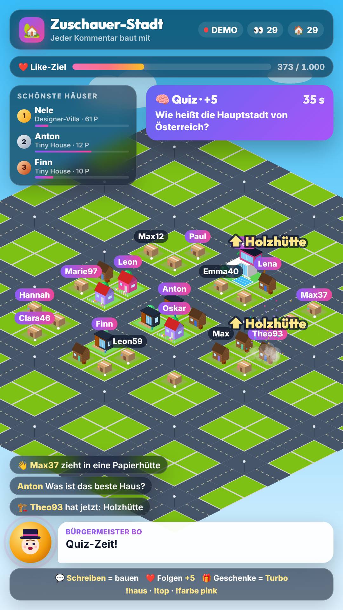

# 🏡 Zuschauer-Stadt – Anleitung für deinen Live

Jeder Zuschauer zieht in eine **Papierhütte**. Wer im Chat schreibt, baut sein Zuhause aus,
Stufe für Stufe bis zur **Riesen-Villa** mit Pool, Palmen und Hubschrauber-Landeplatz.
Ein **Bürgermeister** redet die ganze Zeit mit dem Chat: Er begrüßt neue Leute, gratuliert,
beantwortet Fragen und startet Quiz-Runden.

| Die Stadt im Live | Die Häuser aus der Nähe |
|---|---|
|  |  |

Das Programm läuft **auf deinem Computer** während des Lives. Es liest jeden Kommentar,
jeden neuen Zuschauer, jeden Follow, jedes Teilen, die Likes und die Geschenke mit.

## Die 12 Stufen

| Punkte | Zuhause |
|---|---|
| 0 | Papierhütte (Pappkarton mit Klebeband) |
| 2 | Holzhütte |
| 5 | Gartenhäuschen mit Blumen und Zaun |
| 9 | Tiny House mit Holzterrasse |
| 14 | Bungalow |
| 21 | Einfamilienhaus mit Garage und Auto |
| 30 | Modernes Haus (Kubus, Glasfront) |
| 42 | Haus mit Pool |
| 58 | Designer-Villa |
| 80 | Luxusvilla mit Dachterrasse und Sportwagen |
| 110 | Prachtvilla mit Säulen und Springbrunnen |
| 150 | Riesen-Villa (Gold, Penthouse, Hubschrauber-Landeplatz) |

## Punkte

| Aktion | Punkte |
|---|---|
| Kommentar | +1 (höchstens alle 2 Sekunden pro Person, gegen Spam) |
| Folgen | +5 und eine Fahne aufs Dach |
| Live teilen | +3 |
| Likes | +1 je 50 Likes |
| Geschenk | +1 pro Diamant |
| Quiz gewonnen | +5 |
| Während Bau-Rush | jeder Kommentar zählt doppelt |

## Was sonst noch passiert

- **Bürgermeister:** spricht in einer Sprechblase unten im Bild und auf Wunsch laut (siehe „Stimme“).
  Er antwortet etwa alle 9 Sekunden auf einen Kommentar, Fragen zuerst.
- **Quiz:** alle 6 Minuten eine Frage. Wer zuerst richtig antwortet, bekommt 5 Punkte.
  Eigene Fragen kannst du in `quiz.js` dazuschreiben.
- **Bau-Rush:** alle 10 Minuten für 60 Sekunden doppelte Punkte.
- **Like-Ziel:** Balken oben. Alle 1.000 Likes gibt es ein Feuerwerk und einen Bau-Rush.
- **Tag und Nacht:** alle 8 Minuten ein Durchlauf. Nachts leuchten Fenster, Laternen und Pools.
- **Kamera:** zoomt kurz auf ein Haus, wenn jemand ab dem Einfamilienhaus aufsteigt.
- **Chat-Befehle:** `!haus` (eigener Stand), `!top` (Top 3), `!farbe pink` (Haus anmalen:
  rot, blau, grün, gelb, lila, pink, rosa, orange, schwarz, weiß, türkis, braun, grau, gold, mint, hellblau), `!hilfe`.

## Heute einmal testen (10 Minuten)

1. **Node.js installieren:** https://nodejs.org → „LTS“ herunterladen und installieren.
2. Den Ordner `tiktok-stadt` auf deinen Computer laden.
3. Doppelklick auf **`START-WINDOWS.bat`** (Mac: `START-MAC.command`, beim ersten Mal Rechtsklick → Öffnen).
4. **`2` wählen** = Probelauf mit erfundenen Zuschauern. Es öffnen sich zwei Browser-Tabs:
   die Stadt und die **Regie**. In der Regie auf „Stimme einschalten“ klicken, dann hörst du den Bürgermeister.

## Morgen im Live

1. `START-WINDOWS.bat` starten, **`1`** wählen, deinen TikTok-Namen eingeben (ohne @).
   Das geht schon vor dem Live: Das Programm wartet und verbindet sich, sobald du live bist.
2. Das schwarze Fenster offen lassen. Dort siehst du jeden Kommentar mitlaufen.
3. In der **Regie** (`http://localhost:3000/regie.html`) auf „Stimme einschalten“ klicken.
   Dort kannst du auch selbst ein Quiz, einen Bau-Rush oder ein Feuerwerk starten,
   den Bürgermeister etwas sagen lassen oder ihn pausieren, wenn du selbst reden willst.
4. Die Stadt in den Live bringen:

**A) TikTok LIVE Studio (PC, empfohlen):** Quelle „Link“ bzw. „Browser“ → `http://localhost:3000`,
Größe 1080 × 1920. Damit die Stimme zu hören ist, den **Computer-Ton** (Desktop-Audio) aufnehmen.

**B) OBS:** Quelle „Browser“ → `http://localhost:3000`, Breite 1080, Höhe 1920. Für die Stimme
„Desktop-Audio“ aktiv lassen. Mit `http://localhost:3000/?durchsichtig=1` wird der Himmel durchsichtig.

**C) Nur mit dem Handy:** PC und Handy ins gleiche WLAN. Auf dem PC die IP-Adresse herausfinden
(Windows: `ipconfig` → „IPv4-Adresse“, z. B. 192.168.178.23). Auf dem Handy
`http://192.168.178.23:3000/?stimme=1` öffnen, auf „Ton an“ tippen und in TikTok mit
**Bildschirm teilen** live gehen. (Windows fragt evtl. nach der Firewall → „Zulassen“.)

## Der Bürgermeister mit echter KI (optional)

Ohne Einstellung spricht der Bürgermeister mit vielen vorbereiteten Sätzen. Das funktioniert gut.

Wenn er **frei auf jeden Kommentar antworten** soll, braucht er einen Anthropic-API-Schlüssel.
Dann antwortet Claude (das KI-Modell von Anthropic) als Bürgermeister:

1. Auf https://console.anthropic.com ein Konto anlegen, Guthaben aufladen, unter „API Keys“ einen Schlüssel erstellen.
2. Die Datei `einstellungen.json` im Ordner öffnen (wird beim ersten Start angelegt) und den Schlüssel bei
   `"anthropicApiKey"` zwischen die Anführungszeichen einfügen. Speichern, Programm neu starten.
3. Im schwarzen Fenster steht dann „spricht mit KI“.

**Kosten:** etwa eine Antwort alle 9 Sekunden, grob 2–5 € pro Stunde Live (je nach Betrieb im Chat).
Den Schlüssel niemals im Stream zeigen oder weitergeben. Fällt die KI aus, redet der Bürgermeister
automatisch mit den vorbereiteten Sätzen weiter.

Er ist so eingestellt, dass er freundlich bleibt, Beleidigungen ignoriert und sich von Zuschauern
nicht umprogrammieren lässt. Trotzdem gilt: Du bist für deinen Live verantwortlich. Wenn etwas
schiefläuft, in der Regie auf „Bürgermeister pausieren“ klicken.

## Einstellungen (`einstellungen.json`)

| Feld | Bedeutung |
|---|---|
| `tiktokName` | dein TikTok-Name, dann musst du ihn nicht jedes Mal eingeben |
| `anthropicApiKey` | Schlüssel für den KI-Bürgermeister (leer = vorbereitete Sätze) |
| `moderatorName` | Name des Bürgermeisters |
| `quizAlleMinuten`, `bauRushAlleMinuten` | wie oft (0 = nie automatisch) |
| `bauRushSekunden`, `likeZielSchritt` | Länge des Bau-Rush, Abstand der Like-Ziele |

Weitere Ansicht-Optionen hinten an die Adresse: `?tag=0` (immer Tag), `?ohneliste=1` (ohne Rangliste),
`?katalog=1` (alle 12 Häuser nebeneinander ansehen). Mehrere mit `&` verbinden.

## Gut zu wissen

- **Die Stadt bleibt gespeichert** (Ordner `data`). Beim nächsten Live geht es weiter.
  Neu anfangen: Option `3` beim Start.
- **Verbindung weg?** Das Programm verbindet sich von selbst neu. Die Stadt geht nicht verloren.
- Das Mitlesen läuft über die kostenlose, inoffizielle Bibliothek *TikTok-Live-Connector*.
  TikTok hat dafür keine offizielle Schnittstelle. Wenn TikTok etwas umstellt, kann die Verbindung
  ausfallen → im Ordner `npm install tiktok-live-connector@latest` ausführen. **Deshalb vorher testen.**
- Bei sehr großen Lives schickt TikTok nicht jeden Beitritt und jedes Like mit. Kommentare,
  Follows und Geschenke kommen zuverlässig an.
- Der Bürgermeister schreibt **nicht in den TikTok-Chat**, sondern spricht im Bild und über den Ton.
  Automatisch in den Chat zu schreiben verlangt deine Login-Daten und kann zur Sperre deines Kontos führen.

## Ideen für die Moderation

- Am Anfang: „Jeder hier hat schon eine Papierhütte! Schreibt was, dann baut ihr.“
- Die Top 3 vorlesen: „Nele hat schon eine Designer-Villa! Wer holt sie ein?“
- Vor dem Bau-Rush ankündigen: „Gleich zählt jeder Kommentar doppelt!“
